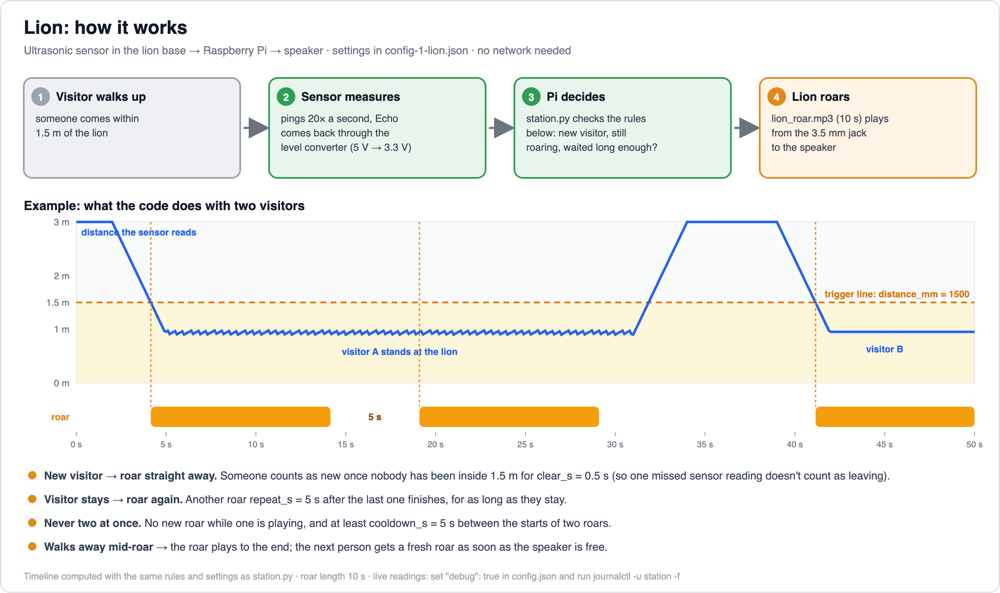
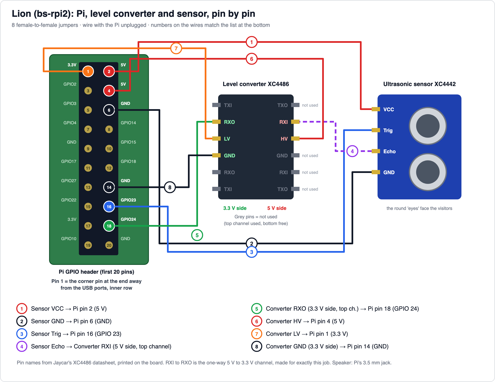
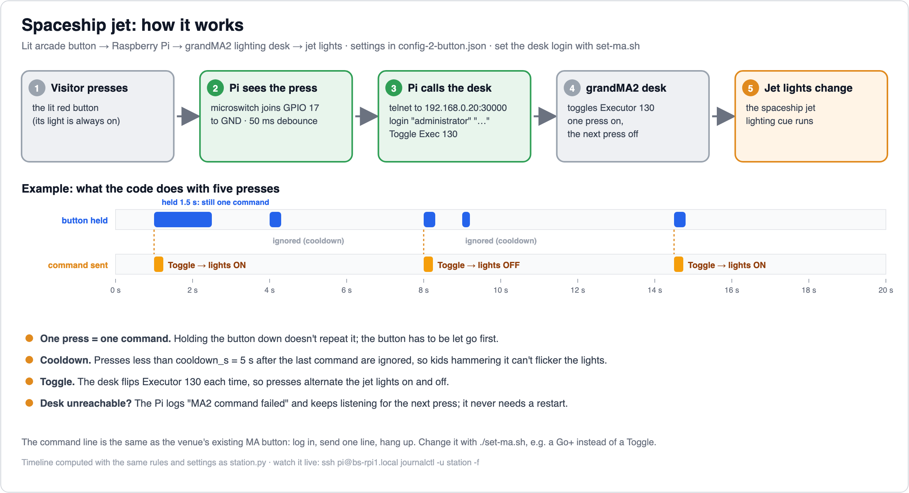
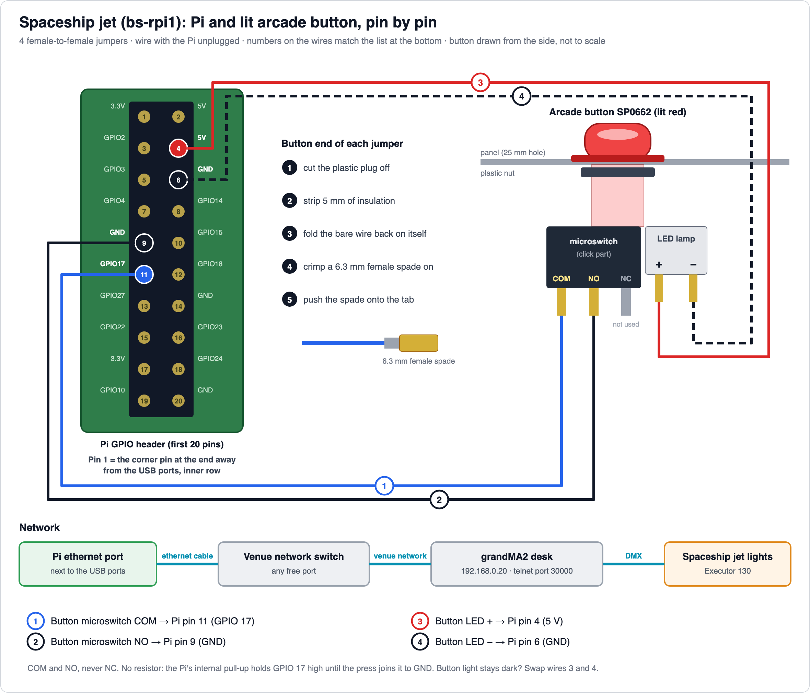
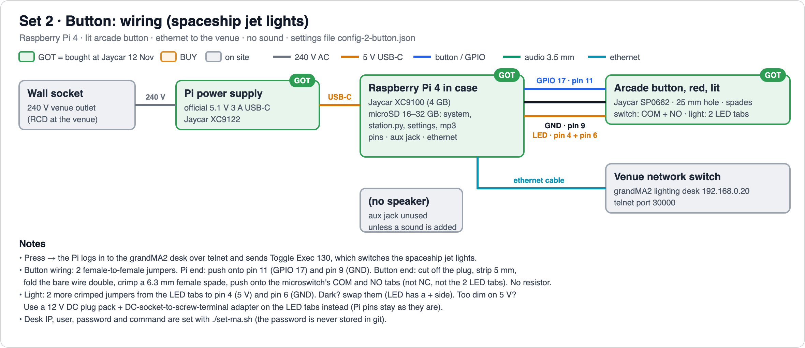

# Balloon Story · Pi Activation Stations

Small Raspberry Pi "activation stations" for the Balloon Story statues. Each station waits for a visitor to do something (walk up to a statue or press a button) and then:

- **plays an mp3** through a speaker, and/or
- **sends a command to the venue's grandMA2 lighting desk** (e.g. to switch the lights on the spaceship jet).

One Python script (`station.py`) runs on every Pi. What each station does is set entirely by its JSON settings file, so the same code covers every set.

| Set | Pi | Trigger | Action | Settings file |
|-----|----|---------|--------|---------------|
| 1 · Lion roar | `bs-rpi2` | Ultrasonic sensor: someone within 1.5 m | Plays `lion_roar.mp3` through a speaker | [`config-1-lion.json`](config-1-lion.json) |
| 2 · Spaceship jet | `bs-rpi1` | Lit arcade button | Sends `Toggle Exec 130` to the grandMA2 desk | [`config-2-button.json`](config-2-button.json) |
| 3 · Spare | – | Lit arcade button | Sends `Toggle Exec 131` (ready to swap in for set 1 or 2) | [`config-3-spare.json`](config-3-spare.json) |

---

## Set 1 · Lion roar

### How it works



The sensor in the lion base measures the distance to whatever is in front of it 20 times a second. When someone comes within 1.5 m, the Pi plays `lion_roar.mp3` (10 s) from its 3.5 mm jack to the speaker.

- **New visitor → roar straight away.** Someone counts as new once nobody has been inside 1.5 m for 0.5 s (`clear_s`), so a single missed sensor reading doesn't count as leaving.
- **Visitor stays → roar again** 5 s (`repeat_s`) after the last roar finishes, for as long as they stay.
- **Never two at once:** no new roar while one is playing, and at least 5 s (`cooldown_s`) between the starts of two roars.

The timeline in the picture comes from running `station.py`'s own rules on a made-up visit (see `wiring/how.py`).

### Wiring, pin by pin



The ultrasonic sensor runs on 5 V and its Echo pin sends back 5 V, but Pi pins only take 3.3 V. That's why Echo goes through the logic level converter's RXI → RXO channel (a 1k/2k resistor divider also works). Trig can go straight to the Pi.

| # | From | To |
|---|------|----|
| 1 | Sensor VCC | Pi pin 2 (5 V) |
| 2 | Sensor GND | Pi pin 6 (GND) |
| 3 | Sensor Trig | Pi pin 16 (GPIO 23) |
| 4 | Sensor Echo | Converter RXI (5 V side, top channel) |
| 5 | Converter RXO (3.3 V side, top channel) | Pi pin 18 (GPIO 24) |
| 6 | Converter HV | Pi pin 4 (5 V) |
| 7 | Converter LV | Pi pin 1 (3.3 V) |
| 8 | Converter GND (3.3 V side) | Pi pin 14 (GND) |

All 8 are female-to-female jumpers: every end pushes onto a pin, no crimping. Wire it with the Pi unplugged.

### Whole station


---

## Set 2 · Spaceship jet button

### How it works



A press joins GPIO 17 to GND. The Pi opens a telnet connection to the grandMA2 desk (`192.168.0.20`, port `30000`), logs in, sends one command line (`Toggle Exec 130`) and hangs up, the same way as the venue's existing MA button. The desk flips Executor 130, so presses alternate the jet lights on and off.

- **One press = one command.** Holding the button down doesn't repeat it.
- **Cooldown:** presses within 5 s (`cooldown_s`) of the last command are ignored.
- **Desk unreachable?** The Pi logs `MA2 command failed` and keeps waiting for the next press.

### Wiring, pin by pin



| # | From | To |
|---|------|----|
| 1 | Button microswitch **COM** | Pi pin 11 (GPIO 17) |
| 2 | Button microswitch **NO** | Pi pin 9 (GND) |
| 3 | Button LED + | Pi pin 4 (5 V) |
| 4 | Button LED − | Pi pin 6 (GND) |

- Use the **COM** and **NO** tabs, never NC. No resistor is needed: the Pi's internal pull-up is used.
- Button end of each jumper: cut the plug off, strip 5 mm, fold the bare wire double, crimp a 6.3 mm female spade and push it onto the tab.
- LED stays dark? Swap wires 3 and 4. Too dim on 5 V? Power the LED tabs from a 12 V DC plug pack instead.
- Ethernet cable from the Pi to the venue network switch (same network as the desk).

### Whole station



### Setting the desk login

The password is **not** stored in git (`config-2-button.json` has `CHANGE_ME`). Set the desk details on the Pi from the Mac:

```bash
./set-ma.sh bs-rpi1 192.168.0.20 administrator '<password>' "Toggle Exec 130"
```

This updates `~/station/config.json` on the Pi and restarts the station.

---

## Set 3 · Spare


Wired exactly like set 2. To swap it in for the button set, copy `config-2-button.json` in as its `config.json`; to replace the lion, move the sensor, converter and jumpers across and use the lion settings.

---

## Parts

| Part | Jaycar code | Used in |
|------|-------------|---------|
| Raspberry Pi 4 (4 GB) in case | XC9100 | all |
| Official 5.1 V 3 A USB-C power supply | XC9122 | all |
| microSD card, 16–32 GB | – | all |
| Ultrasonic distance sensor | XC4442 | set 1 |
| Logic level converter | XC4486 | set 1 |
| Lit arcade button, red, 25 mm | SP0662 | sets 2, 3 |
| Female-to-female jumper wires | – | all |
| 6.3 mm female spade crimps | – | sets 2, 3 |
| Stick-on heatsinks (see [where they go](wiring/pi4-heatsinks.png)) | – | all |
| Speaker + 3.5 mm aux cable | on site | set 1 |
| Ethernet cable | on site | sets 2, 3 |

---

## Setting up a Pi

### 1. Flash the SD card

In **Raspberry Pi Imager**, flash Raspberry Pi OS (Lite is fine) and in the settings:

- hostname: `bs-rpi2` for the lion, `bs-rpi1` for the jet button (any name works)
- username: `pi`
- enable SSH and add your Mac's public SSH key
- set up Wi-Fi if the Pi won't be on ethernet during setup

### 2. Run the setup script from your Mac

With the Pi powered on and on the same network as the Mac:

```bash
./setup-pi.sh lion bs-rpi2      # set type, then the Pi's hostname
./setup-pi.sh button bs-rpi1
./set-ma.sh bs-rpi1 192.168.0.20 administrator '<password>' "Toggle Exec 130"   # button only
```

The setup script:

1. copies `station.py`, `station.service` and the set's settings file (as `config.json`) to `~/station/` on the Pi, plus the mp3 for the lion
2. installs `mpg123`, `gpiozero`, `lgpio` and ALSA tools
3. sets the timezone to Australia/Perth and the headphone-jack volume to 90%
4. installs and starts a systemd service, so the station starts on boot and restarts itself if it crashes

### 3. Check it's working

```bash
ssh pi@bs-rpi2.local journalctl -u station -f
```

You should see `Triggered` each time someone walks up or the button is pressed, and `MA2 command sent: Toggle Exec 130` on the button Pi. To see the lion sensor's live distance readings, add `"debug": true` to its `config.json` and restart.

---

## Settings (`config.json`)

| Key | Meaning |
|-----|---------|
| `trigger` | `"button"` or `"distance"` (ultrasonic sensor) |
| `button_gpio` | GPIO number the button is on (BCM numbering) |
| `trigger_gpio`, `echo_gpio` | GPIO numbers for the ultrasonic sensor's Trig and Echo |
| `distance_mm` | Fire when someone is closer than this (sensor only) |
| `max_distance_m` | Furthest distance the sensor reports (sensor only) |
| `cooldown_s` | Minimum seconds between the starts of two triggers |
| `clear_s` | Seconds with nobody there (or the button released) before the next visitor counts as new |
| `repeat_s` | Someone who stays gets another trigger this many seconds after the sound ends; `0` or missing = never |
| `play_sound` | `true` to play `mp3_file` |
| `mp3_file` | Full path of the mp3 on the Pi |
| `audio_device` | ALSA device; `plughw:CARD=Headphones,DEV=0` is the 3.5 mm jack |
| `send_ma` | `true` to send `ma_command` to the grandMA2 desk |
| `ma_ip`, `ma_port` | Desk address; telnet is port `30000` |
| `ma_user`, `ma_pass` | Desk login (set with `set-ma.sh`, not in git) |
| `ma_command` | One grandMA2 command line, e.g. `Toggle Exec 130` |
| `send_udp` | `true` to send `udp_message` (not used at the moment) |
| `udp_ip`, `udp_port`, `udp_message` | Where and what to send over UDP |
| `debug` | `true` to log the sensor distance twice a second |

To change settings on a running Pi, edit `~/station/config.json` and run `sudo systemctl restart station` (or edit the file here and re-run `setup-pi.sh`).

---

## Files

```
station.py            the program that runs on every Pi
station.service       systemd unit: starts station.py on boot, restarts on crash
setup-pi.sh           one-command setup of a Pi over SSH from a Mac
set-ma.sh             sets the grandMA2 desk IP, login and command on a button Pi
config-1-lion.json    settings for set 1 (lion roar)
config-2-button.json  settings for set 2 (spaceship jet button)
config-3-spare.json   settings for set 3 (spare button)
lion_roar.mp3         sound played by the lion
wiring/               diagrams (PNG + SVG) and the scripts that draw them:
  gen.py                whole-station overviews (set1/2/3-*-wiring)
  lionpins.py           lion pin-by-pin sheet
  jetpins.py            spaceship jet pin-by-pin sheet
  how.py                "how it works" sheets for the lion and the jet
  heatsinks.py          where the Pi 4 heatsinks go
  render.sh             runs all of the above and exports the PNGs
```

To redraw the diagrams after editing a script (needs Google Chrome for the PNG export):

```bash
cd wiring && ./render.sh
```
