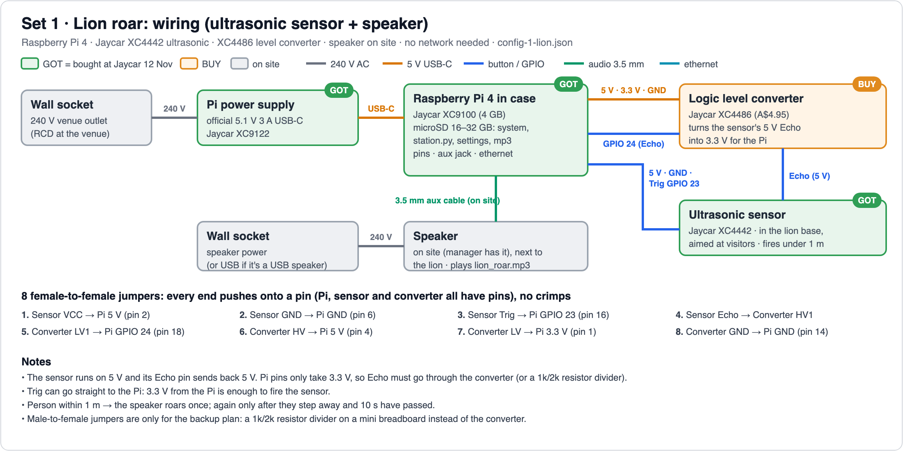
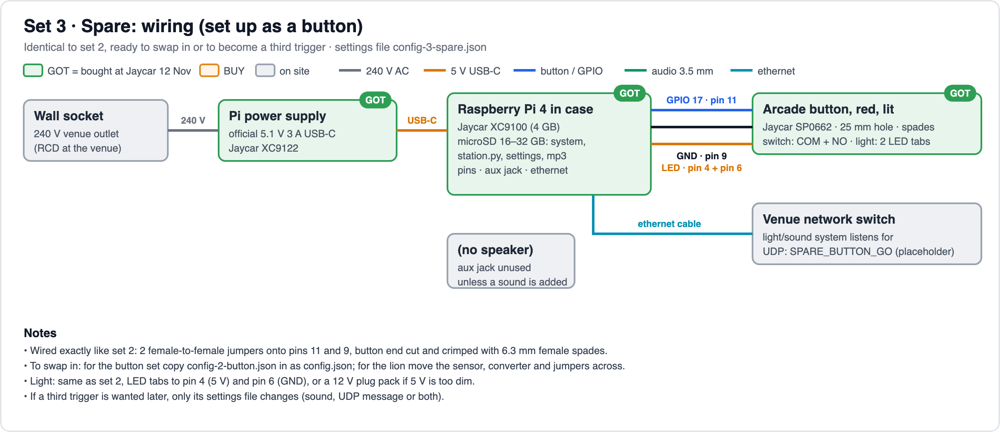

# Balloon Story · Pi Activation Stations

Small Raspberry Pi "activation stations" for the Balloon Story statues. Each station waits for a visitor to do something (press a button or walk up to a statue) and then:

- **plays an mp3** through a speaker, and/or
- **sends a UDP message** to the venue's light/sound system (e.g. to change the lights on the spaceship jet).

One Python script (`station.py`) runs on every Pi. What each station does is set entirely by its JSON settings file, so the same code covers all three sets.

| Set | Trigger | Action | Settings file |
|-----|---------|--------|---------------|
| 1 · Lion roar | Ultrasonic sensor: someone within 1 m | Plays `lion_roar.mp3` through a speaker | [`config-1-lion.json`](config-1-lion.json) |
| 2 · Spaceship jet | Lit arcade button | Sends UDP `SPACESHIP_JET_GO` to the venue | [`config-2-button.json`](config-2-button.json) |
| 3 · Spare | Lit arcade button | Sends UDP `SPARE_BUTTON_GO` (ready to swap in for set 1 or 2) | [`config-3-spare.json`](config-3-spare.json) |

> The UDP message, IP and port in sets 2 and 3 are **placeholders** until the venue tells us what its system listens for.

---

## Wiring

### Set 1 · Lion roar (ultrasonic sensor + speaker)



The ultrasonic sensor runs on 5 V and its Echo pin sends back 5 V, but Pi pins only take 3.3 V. That's why Echo goes through the logic level converter (a 1k/2k resistor divider also works). Trig can go straight to the Pi.

| # | From | To |
|---|------|----|
| 1 | Sensor VCC | Pi 5 V (pin 2) |
| 2 | Sensor GND | Pi GND (pin 6) |
| 3 | Sensor Trig | Pi GPIO 23 (pin 16) |
| 4 | Sensor Echo | Converter HV1 |
| 5 | Converter LV1 | Pi GPIO 24 (pin 18) |
| 6 | Converter HV | Pi 5 V (pin 4) |
| 7 | Converter LV | Pi 3.3 V (pin 1) |
| 8 | Converter GND | Pi GND (pin 14) |

### Set 2 · Button (spaceship jet lights)


| From | To |
|------|----|
| Button microswitch **COM** | Pi GPIO 17 (pin 11) |
| Button microswitch **NO** | Pi GND (pin 9) |
| Button LED tab + | Pi 5 V (pin 4) |
| Button LED tab − | Pi GND (pin 6) |

- Use the **COM** and **NO** tabs, not NC. No resistor needed (the Pi's internal pull-up is used).
- Button end: cut the jumper plug off, strip 5 mm, fold the wire double and crimp a 6.3 mm female spade.
- LED stays dark? Swap its two wires. Too dim on 5 V? Power the LED tabs from a 12 V DC plug pack instead.
- Ethernet cable from the Pi to the venue network switch.

### Set 3 · Spare (set up as a button)



Wired exactly like set 2. To swap it in for the button set, copy `config-2-button.json` in as its `config.json`; to replace the lion, move the sensor, converter and jumpers across and use the lion settings.

---

## Parts

| Part | Jaycar code | Used in |
|------|-------------|---------|
| Raspberry Pi 4 (4 GB) in case | XC9100 | all |
| Official 5.1 V 3 A USB-C power supply | XC9122 | all |
| microSD card, 16–32 GB | – | all |
| Ultrasonic distance sensor | XC4442 | set 1 |
| Logic level converter | XC4486 | set 1 |
| Lit arcade button, red, 25 mm | SP0662 | sets 2, 3 |
| Female-to-female jumper wires | – | all |
| 6.3 mm female spade crimps | – | sets 2, 3 |
| Speaker + 3.5 mm aux cable | on site | set 1 |
| Ethernet cable | on site | sets 2, 3 |

---

## Setting up a Pi

### 1. Flash the SD card

In **Raspberry Pi Imager**, flash Raspberry Pi OS (Lite is fine) and in the settings:

- hostname: `bs-lion`, `bs-button` or `bs-spare`
- username: `pi`
- enable SSH and add your Mac's public SSH key
- set up Wi-Fi if the Pi won't be on ethernet during setup

### 2. Run the setup script from your Mac

With the Pi powered on and on the same network as the Mac:

```bash
./setup-pi.sh lion      # or: button, spare
./setup-pi.sh button my-pi-name   # optional custom hostname (default is bs-<set>)
```

The script:

1. copies `station.py`, `station.service` and the set's settings file (as `config.json`) to `~/station/` on the Pi, plus the mp3 for the lion
2. installs `mpg123`, `gpiozero`, `lgpio` and ALSA tools
3. sets the timezone to Australia/Perth and the headphone-jack volume to 90%
4. installs and starts a systemd service, so the station starts on boot and restarts itself if it crashes

### 3. Check it's working

```bash
ssh pi@bs-lion.local journalctl -u station -f
```

You should see `Triggered` each time the button is pressed or someone walks up.

---

## Settings (`config.json`)

| Key | Meaning |
|-----|---------|
| `trigger` | `"button"` or `"distance"` (ultrasonic sensor) |
| `button_gpio` | GPIO number the button is on (BCM numbering) |
| `trigger_gpio`, `echo_gpio` | GPIO numbers for the ultrasonic sensor's Trig and Echo |
| `distance_mm` | Fire when someone is closer than this (sensor only) |
| `cooldown_s` | Minimum seconds between two triggers |
| `play_sound` | `true` to play `mp3_file` |
| `mp3_file` | Full path of the mp3 on the Pi |
| `audio_device` | ALSA device; `plughw:CARD=Headphones,DEV=0` is the 3.5 mm jack |
| `send_udp` | `true` to send `udp_message` |
| `udp_ip`, `udp_port`, `udp_message` | Where and what to send to the venue system |

A station fires only on a **new** press or a **new** person: someone standing in front of the lion triggers one roar, and it can roar again only after they step away and the cooldown has passed.

To change settings on a running Pi, edit `~/station/config.json` and run `sudo systemctl restart station` (or edit the file here and re-run `setup-pi.sh`).

---

## Files

```
station.py            the program that runs on every Pi
station.service       systemd unit: starts station.py on boot, restarts on crash
setup-pi.sh           one-command setup of a Pi over SSH from a Mac
config-1-lion.json    settings for set 1 (lion roar)
config-2-button.json  settings for set 2 (spaceship jet button)
config-3-spare.json   settings for set 3 (spare button)
lion_roar.mp3         sound played by the lion
wiring/               wiring diagrams (PNG + SVG) and gen.py, which draws them
```

To redraw the wiring diagrams after editing `wiring/gen.py`:

```bash
cd wiring && python3 gen.py   # writes the .svg files
```

The PNGs are exports of those SVGs.
